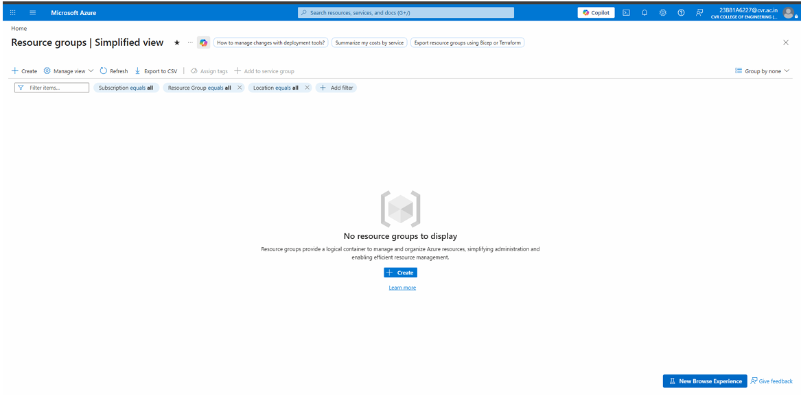
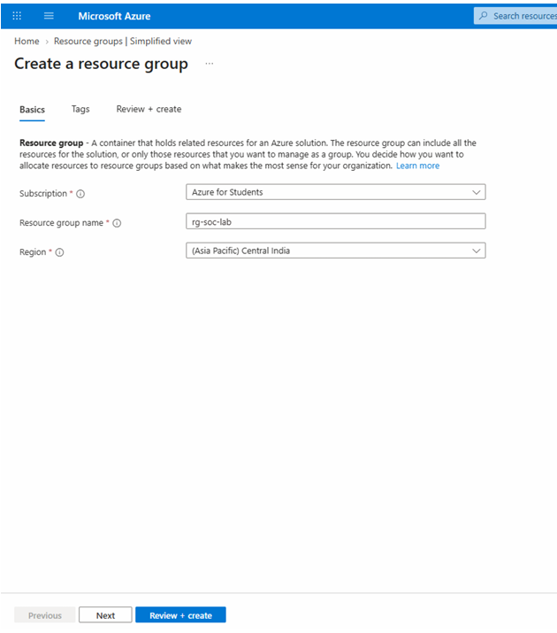
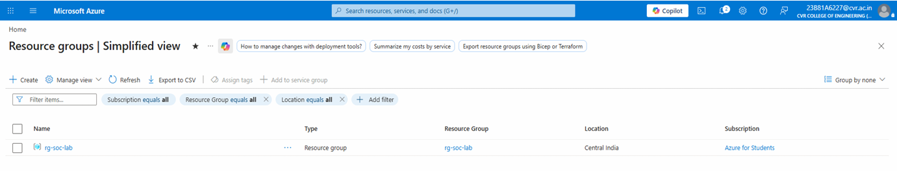

# I. Create a Resource Group

A Resource Group helps organise and manage related Azure resources in one place.

1. Type **Resource Group** in the Azure Portal search bar and click **Create**.

   

2. Enter the following details:

   - **Resource Group Name:** `rg-soc-lab`
   - **Region:** `Central India`

   

3. Click **Create**. The Resource Group is successfully created.

   
