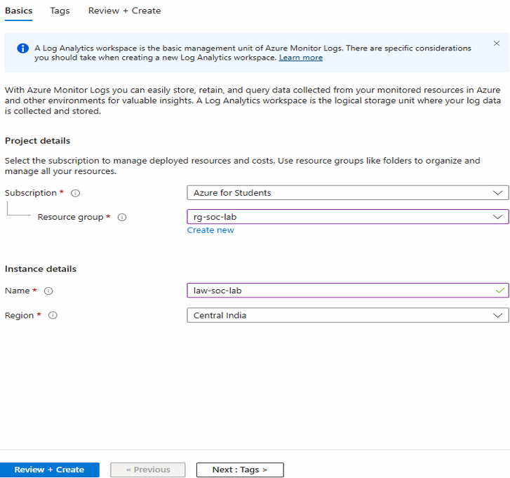
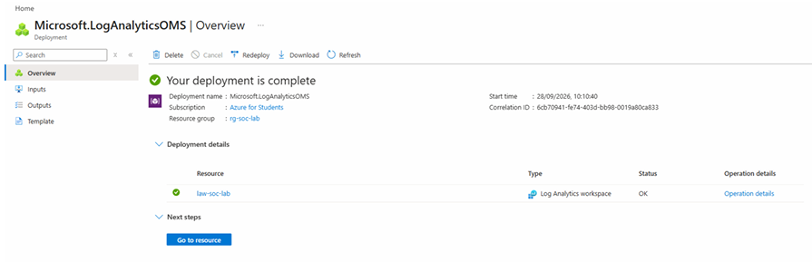

# II. Create a Log Analytics Workspace

A Log Analytics Workspace collects and stores logs from Azure resources so they can be queried and analysed.

1. Search **Log Analytics workspaces** in the Azure Portal and click **Create**.

2. Enter the details:

   - **Subscription:** Azure for Students
   - **Resource Group:** `rg-soc-lab`
   - **Name:** `law-soc-lab`
   - **Region:** Central India

   Click **Review + Create**, then click **Create**.

   

3. The Log Analytics Workspace is successfully created.

   
