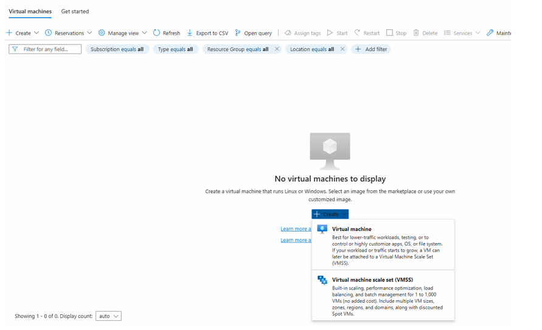
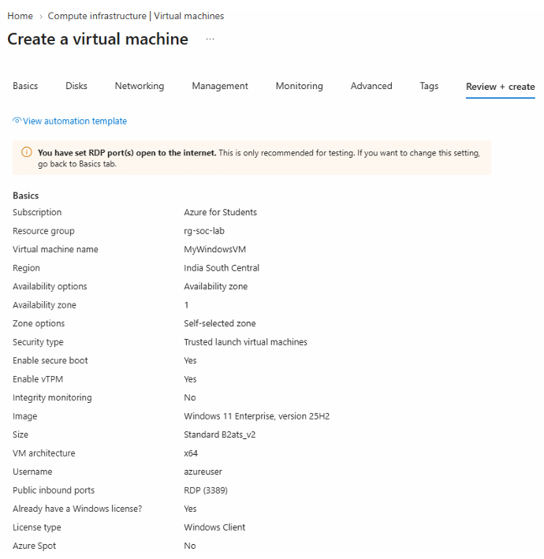
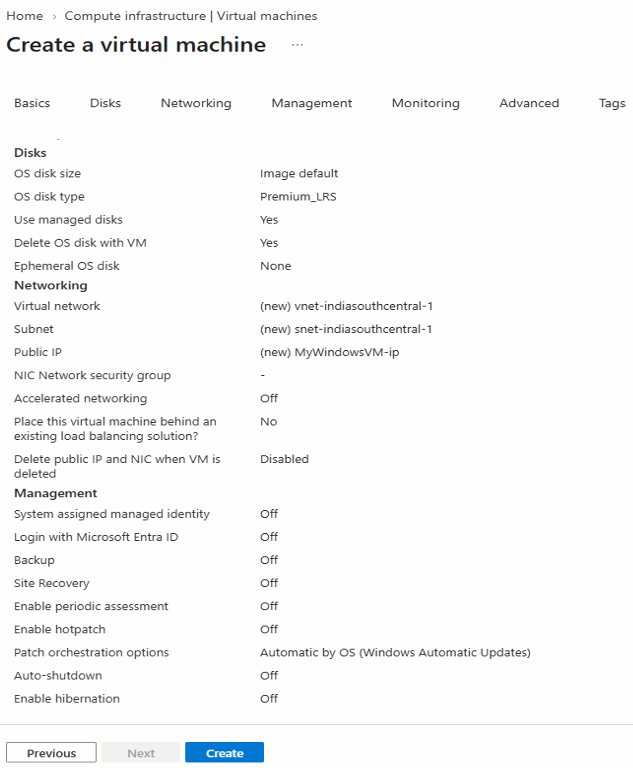
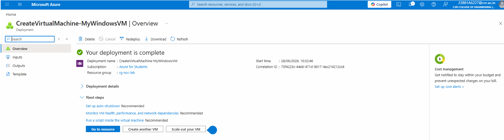

# IV. Create a Windows Virtual Machine

1. Go to **Policy → Assignments → Allowed Resource deployment regions**. Check the allowed regions:

   - `indiasouthcentral`
   - `malaysiawest`
   - `centralindia`
   - `koreacentral`
   - `eastasia`

   We will use **India South Central**.

2. Search for **Virtual machines** in the Azure Portal. Click **Create → Virtual machine**.

   

3. Enter the following details:

   | Setting | Select |
   |---|---|
   | Subscription | Your subscription |
   | Resource group | `rg-soc-lab` |
   | VM name | `MyWindowsVM` |
   | Region | India South Central |
   | Image | Windows 11 Pro |
   | Size | A small eligible size |
   | Username | `azureuser` |
   | Password | `<your_password>` |

   

   

4. Click **Create**. The following screen appears after deployment.

   
