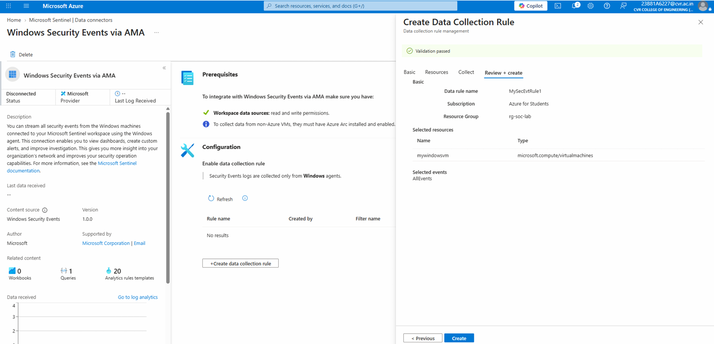
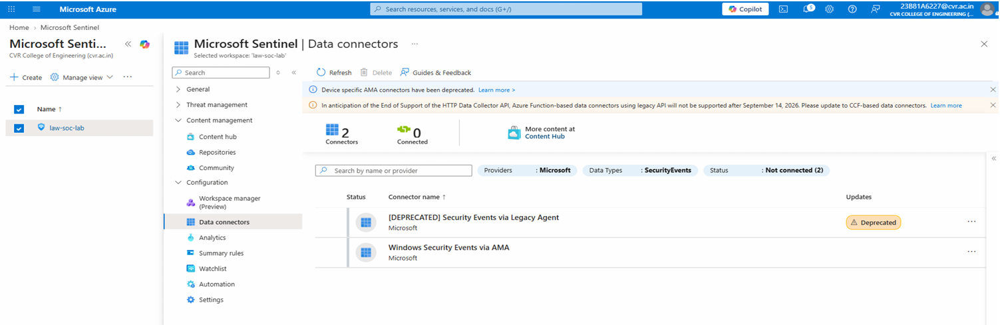

# V. Configure Microsoft Sentinel Data Connector

1. Search for **Microsoft Sentinel** in the Azure Portal and open `law-soc-lab`.

2. Go to **Configuration → Data connectors**.

3. Search for **Windows Security Events via AMA** and open the connector page.

4. Click **+ Create data collection rule**. A panel opens on the right.

5. Enter the following details:

   - **Data rule name:** `MySecEvtRule1`
   - **Subscription:** Azure for Students
   - **Resource group:** `rg-soc-lab`

6. Click **Next → + Add resource(s)**. Select `MyWindowsVM` and click **Apply**.

7. Click **Next** and select **Common**.

8. Click **Review + create**. Make sure **Validation passed** is displayed.

9. Click **Create**.

   

10. Return to the **Windows Security Events via AMA** connector page. Click **Refresh** and verify that the Data Collection Rule appears under Configuration.

    
