# VI. Generate Windows security events and verify that Sentinel is receiving them.

1. Go to Virtual Machines.

2. Open MyWindowsVM → Connect → RDP → Download RDP file.

   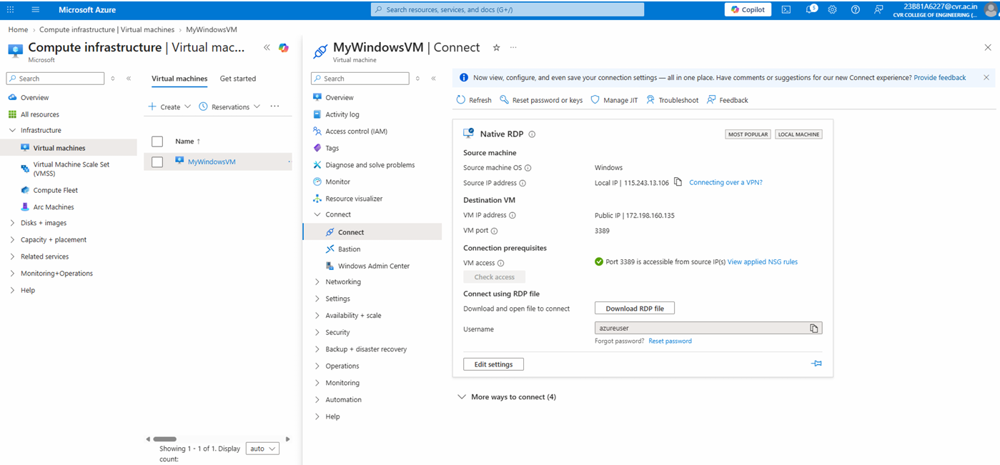

3. Open the downloaded .rdp file on your PC and connect using the username and password you created for the VM.

   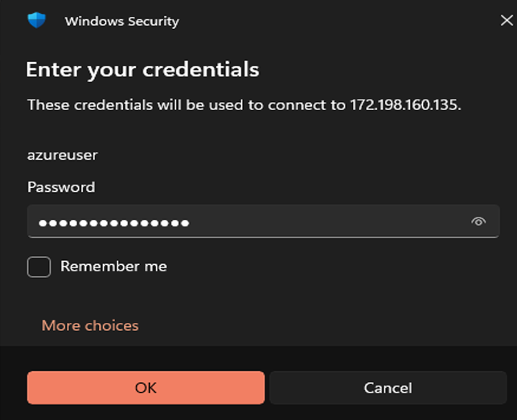

4. Then we get connected to azureuser remotely.

   

   (or)

   - Install Windows App (if you dont want to download and use the RDP file to access the Windows VM)
   - If you face errors while connecting:
     Go to: Azure Portal → MyWindowsVM → Overview. Then Click Restart.

5. Open cmd, run as administrator.
   Enter the following commands, to create users and an admin. (We created 4 soc users and 1 soc admin user ).

   Syntax: `net user <username> "<password>" /add`

   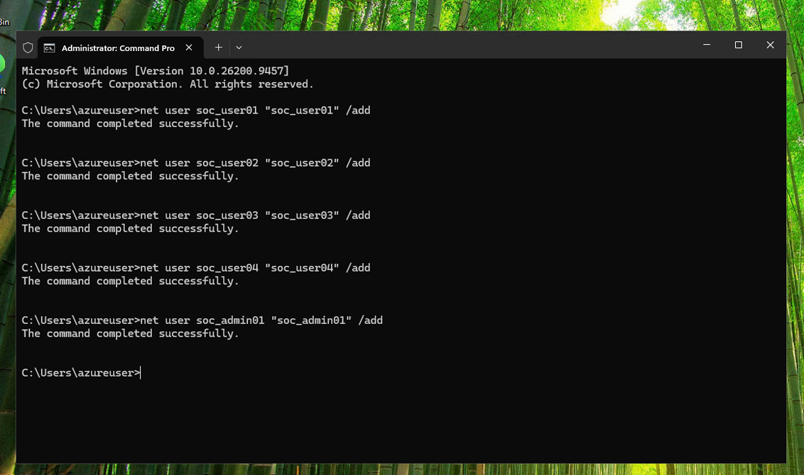

6. Check that the users were created using net user command.

   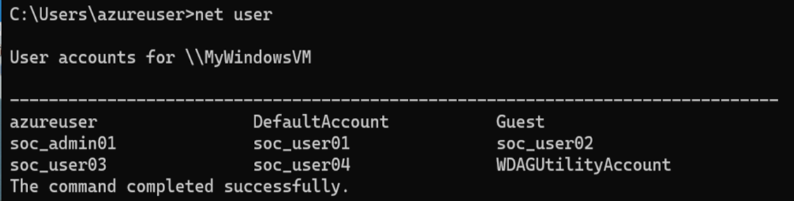

   - net user allows you to check the existing user.
   - You can also check an individual user. Ex: net user soc_user01.

   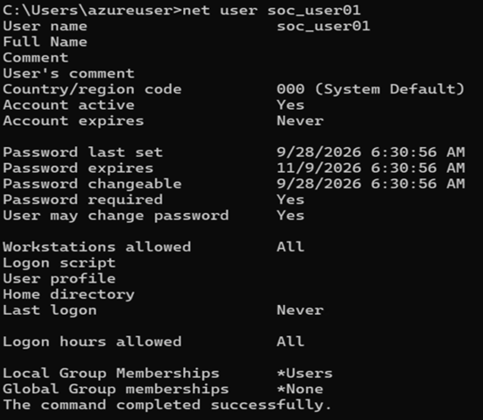

7. net localgroup command allows you to see all the local groups available on the Windows VM.

   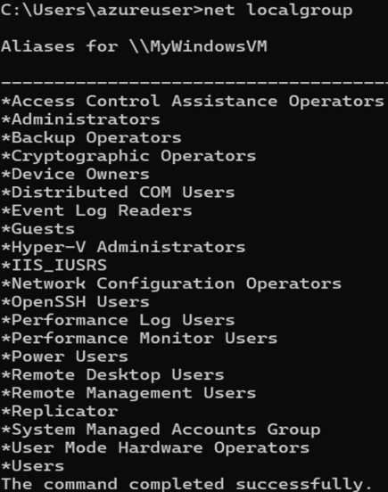

8. Add soc_admin01 to the Administrators group using the command: net localgroup Administrators soc_admin01 /add. This gives soc_admin01 local administrator privileges.

   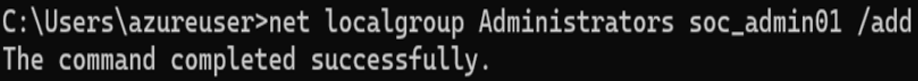

9. Verify that soc_admin01 was added successfully using the command: net localgroup Administrators. The soc_admin01 account should now appear in the list.

   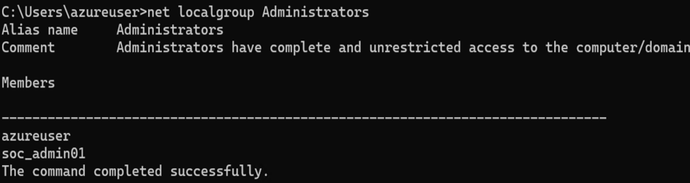

10. Open Event Viewer by searching for it in the Windows search bar.

11. Go to Windows Logs → Security.

12. Look for Event ID 4732. This event is generated when a member is added to a security-enabled local group.

13. Right-click the 4732 event and select Event Properties to view the details of the event.

    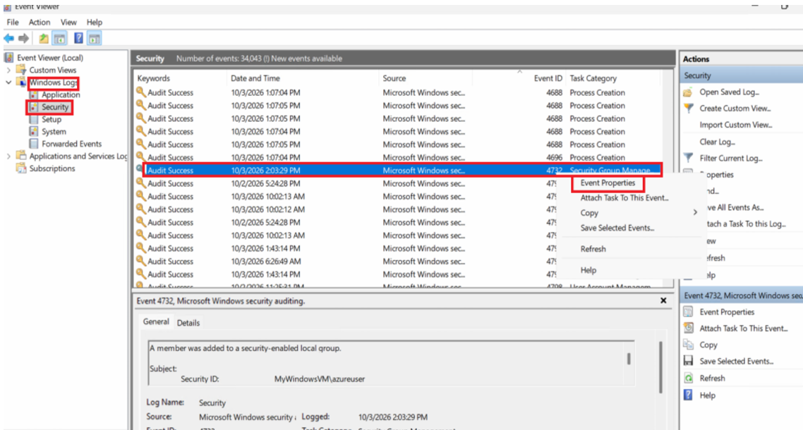

    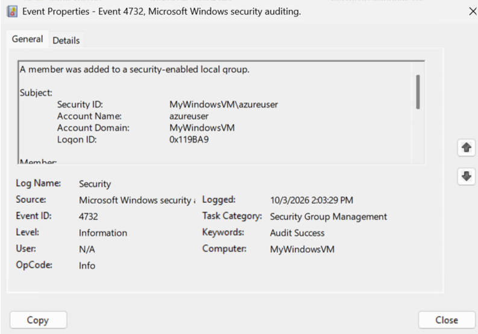

14. Open Command Prompt as Administrator and add soc_user01 to the Remote Desktop Users group: `net localgroup "Remote Desktop Users" soc_user01 /add`. Add all the users similarly including soc_admin01.

    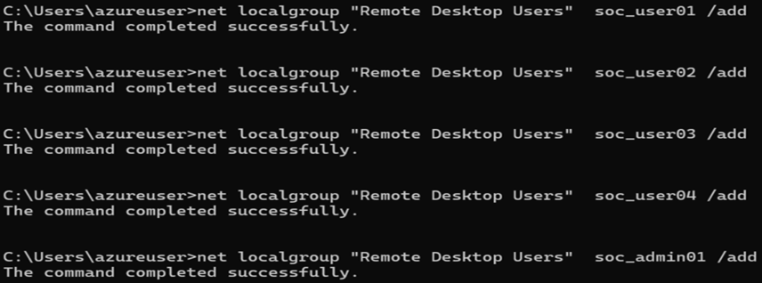

    This adds all the users to the Remote Desktop Users group, allowing the account to connect to the Windows VM through Remote Desktop.

15. Verify that the users were added successfully: `net localgroup "Remote Desktop Users"`

    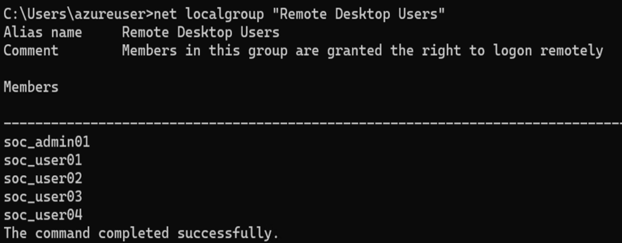

16. Close the current Remote Desktop session.

17. Open Remote Desktop / Windows App

18. When prompted for credentials, select Use another account and enter:

    Username: soc_user01

    Password: soc_user01

    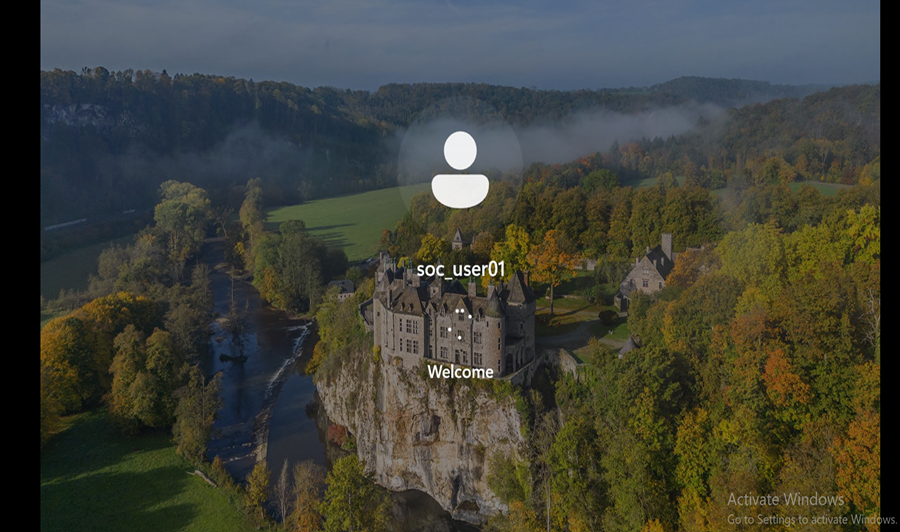

19. After successfully connecting, open Microsoft Sentinel → law-soc-lab → Logs.

20. Switch from Simple Mode to KQL Mode.

21. Run the following query to verify that Windows Security events are being received:

    ```kql
    SecurityEvent
    | take 10
    ```

    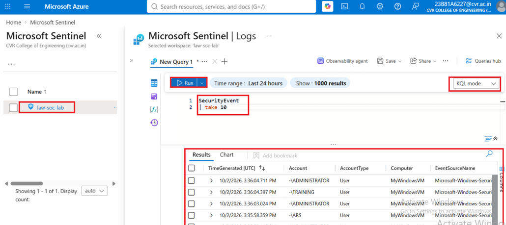

    This displays 10 Windows Security events collected from the VM

22. To verify the Event ID 4732 generated earlier, run:

    ```kql
    SecurityEvent
    | where EventID == 4732
    | order by TimeGenerated desc
    ```

    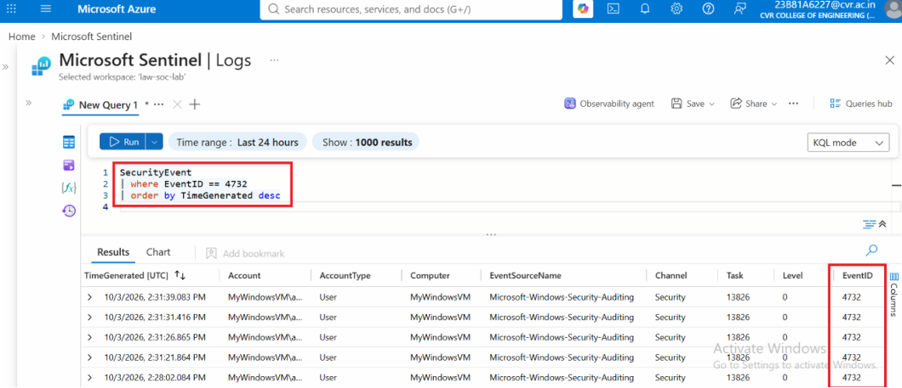

    This displays the most recent events where a user was added to a local security-enabled group.

23. To verify the successful login made using soc_user01, run:

    ```kql
    SecurityEvent
    | where EventID == 4624
    | order by TimeGenerated desc
    ```

    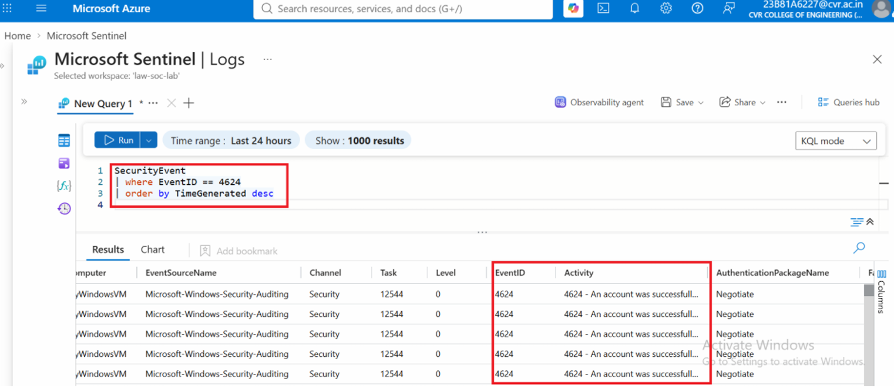

    Event ID 4624 represents a successful logon.
