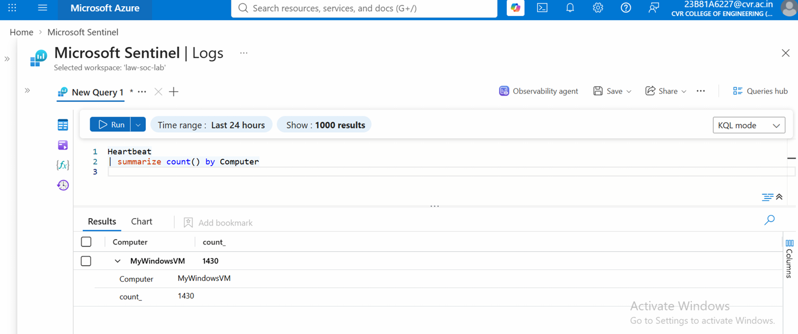
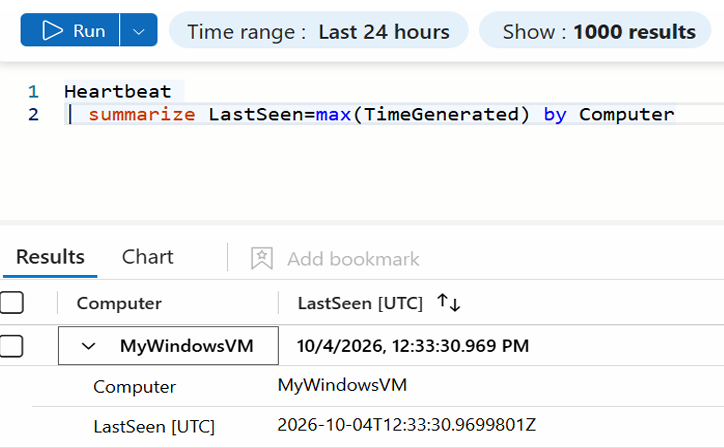
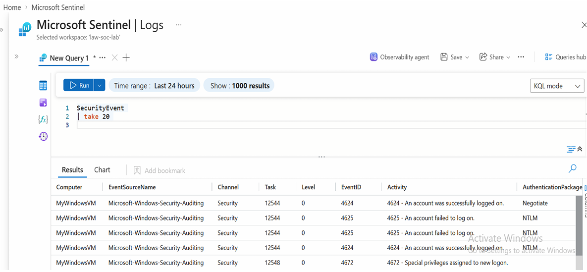
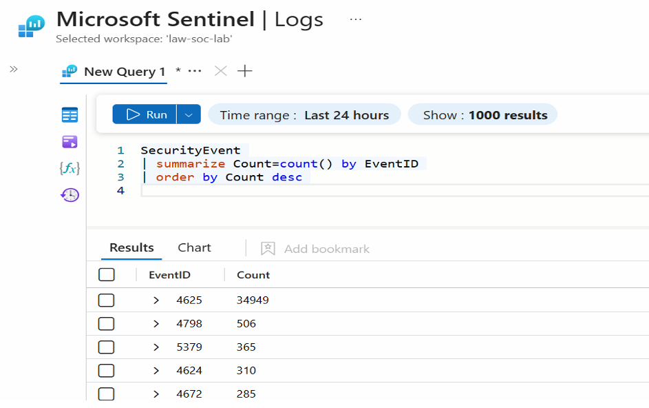
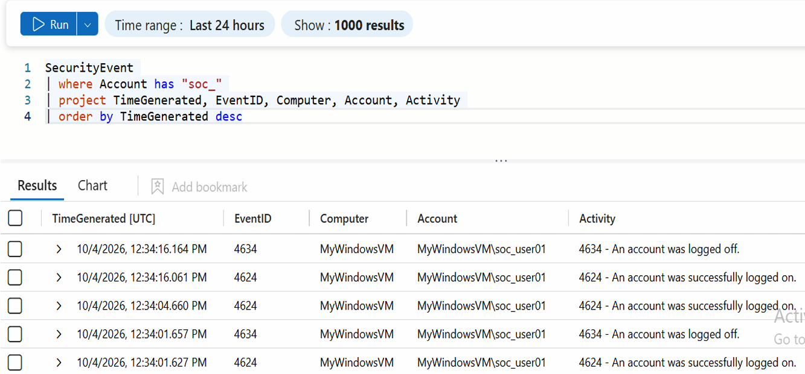

# VII. Prerequisites Before Simulating Attacks

### 1. Check Heartbeat Status (Verify Sentinel before attacks)

To check whether the VM is sending heartbeat information to Sentinel, run:

```kql
Heartbeat
| summarize count() by Computer
```
  

This means:

- Computer: MyWindowsVM → this is your Windows VM.
- count_: 1430 → Sentinel has received 1,430 heartbeat records from MyWindowsVM within the selected Last 24 hours time range.

```kql
Heartbeat
| summarize LastSeen=max(TimeGenerated) by Computer
```
  

### 2. Check SecurityEvent

```kql
SecurityEvent
| take 20
```
  

If you get records, your Windows Security Event ingestion is working.

### 3. Check the event IDs

```kql
SecurityEvent
| summarize Count=count() by EventID
| order by Count desc
```
  

### 4. Check the current user activity

```kql
SecurityEvent
| where Account has "soc_"
| project TimeGenerated, EventID, Computer, Account, Activity
| order by TimeGenerated desc
```
   
