# VIII. Attack Simulations

### 1. Failed Login / Brute-Force Simulation

- Open Remote Desktop / Windows App and connect to `MyWindowsVM`.
- At the Windows login screen, select **Use another account**.
- Enter:
  - Username: `soc_user01`
- Enter an intentionally incorrect password:
  - `WrongPassword@123`
- Click **Sign in**.
- Repeat the failed login approximately 5 times.
- The expected event is **Event ID 4625 — An account failed to log on.**

**Microsoft Sentinel**

- Open Microsoft Sentinel → `law-soc-lab` → Logs.
- Run:

```kql
SecurityEvent
| where EventID == 4625
| where Account has "soc_"
| project TimeGenerated, Computer, Account, IpAddress, LogonType, Activity
| order by TimeGenerated desc
```

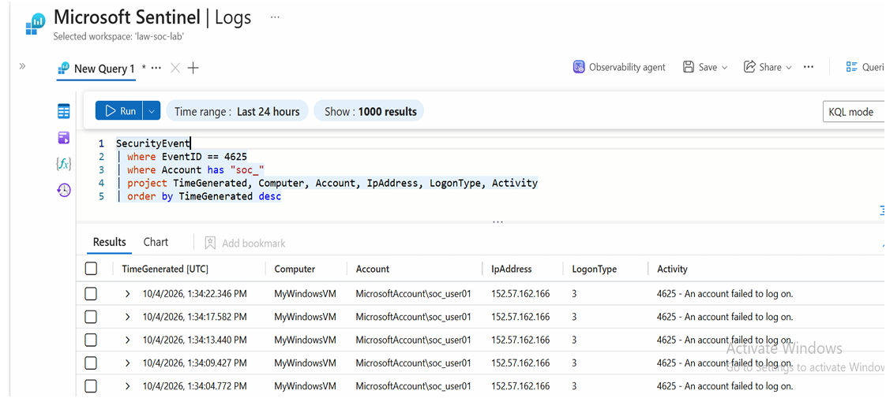

- To detect 5 or more failed attempts within 5 minutes, run:

```kql
SecurityEvent
| where EventID == 4625
| summarize FailedAttempts=count() by Account, IpAddress, bin(TimeGenerated, 5m)
| where FailedAttempts >= 5
| order by TimeGenerated desc
```

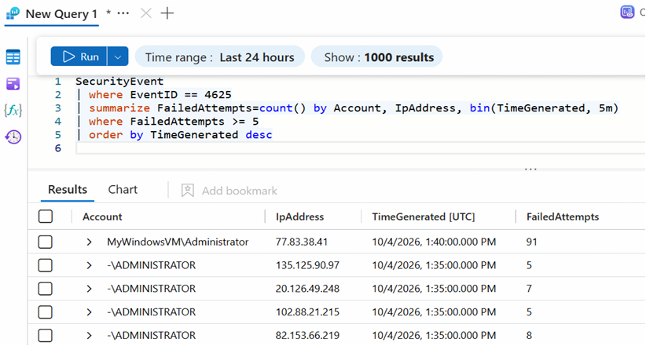

This identifies potential brute-force activity when the same account has 5 or more failed login attempts within a 5-minute window. This is a detection hypothesis that requires further investigation, not proof of an attack.

### 2. Failed Login → Successful Login

- After generating the failed login attempts, connect to `MyWindowsVM` again.
- Log in using:
  - Username: `soc_user01`
  - Enter the correct password for `soc_user01`.
- Open Microsoft Sentinel → `law-soc-lab` → Logs.
- Run:

```kql
SecurityEvent
| where EventID in (4624, 4625)
| where Account has "soc_"
| project TimeGenerated, EventID, Computer, Account, IpAddress, LogonType, Activity
| order by TimeGenerated desc
```

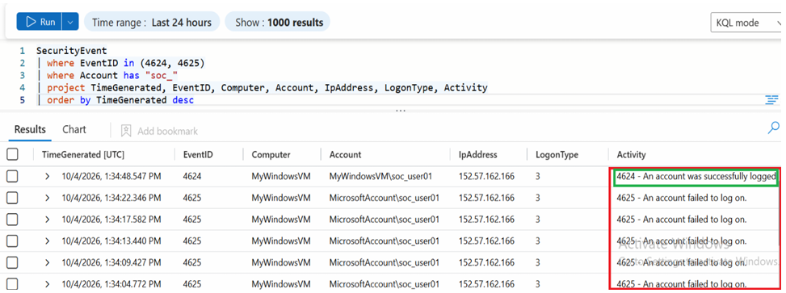

- Check the timeline of events. You should see a sequence similar to:

| Event ID | Status |
|---|---|
| 4625 | Failed |
| 4625 | Failed |
| 4625 | Failed |
| 4625 | Failed |
| 4624 | Successful |

- This lets you investigate a sequence of failed login attempts followed by a successful login.

### 3. Password Spray Simulation

- Open the Windows login interface.
- Attempt to log in using:
  - `soc_user01`
  - `soc_user02`
  - `soc_user03`
  - `soc_user04`
- Use the same deliberately incorrect password for each account: `WrongPassword@123`.

- The concept being demonstrated is:
  - **Brute Force:** One account → Many passwords.
  - **Password Spray:** One password → Many accounts.

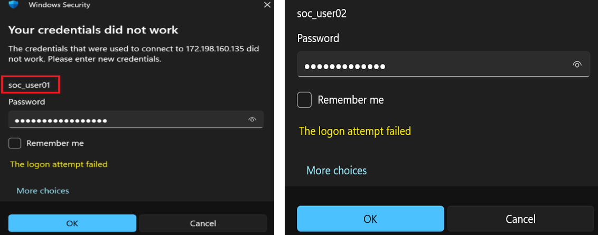

- Repeat the process with the other users.
- Then open Microsoft Sentinel → `law-soc-lab` → Logs.
- Run the password-spray query shown below:

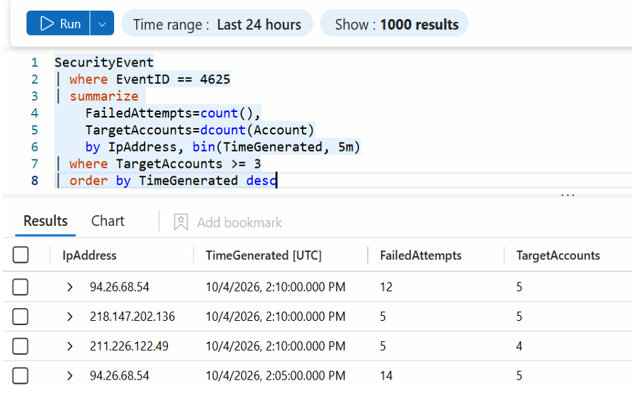

- Check the `TargetAccounts` value.
- `dcount(Account)` counts the number of distinct accounts targeted.

### 4. Unauthorized Account Creation

- Open Command Prompt as Administrator.
- Create a temporary test account:

```cmd
net user soc_test01 "LabTest@123" /add
```

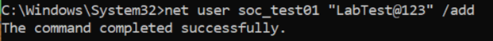

- This should generate **Event ID 4720 — A user account was created.**
- Open Microsoft Sentinel → `law-soc-lab` → Logs.
- Run:

```kql
SecurityEvent
| where EventID == 4720
| project TimeGenerated, Computer, SubjectUserName, TargetUserName, Account, Activity
| order by TimeGenerated desc
```

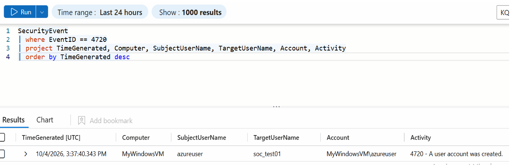

- SOC investigation: Who created `soc_test01`?

### 5. Privilege Escalation

- Open Command Prompt as Administrator.
- Add the standard user `soc_user01` to the local Administrators group:

```cmd
net localgroup Administrators soc_user01 /add
```

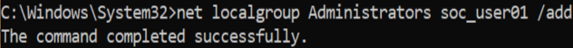

- This should generate **Event ID 4732 — A member was added to a security-enabled local group.**

**Microsoft Sentinel**

- Open Microsoft Sentinel → `law-soc-lab` → Logs.
- Run:

```kql
SecurityEvent
| where EventID == 4732
| project TimeGenerated, Computer, SubjectUserName, MemberName, TargetUserName, Activity
| order by TimeGenerated desc
```

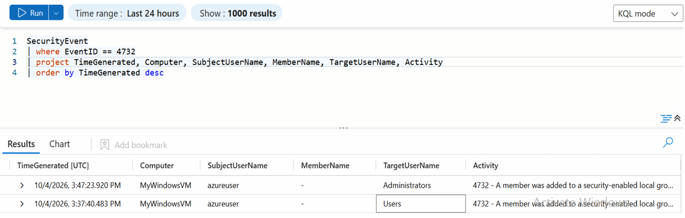

- Investigate: Why was a standard account added to the local Administrators group?

### 6. Privileged Logon

- Log out of the Windows VM.
- Log in using:
  - Username: `soc_user01`
- Since `soc_user01` was added to the Administrators group in the previous simulation, it now has local administrator privileges.
- Open Microsoft Sentinel → `law-soc-lab` → Logs.
- Run:

```kql
SecurityEvent
| where EventID == 4672
| where Account has "soc_"
| project TimeGenerated, Computer, Account, SubjectUserName, Activity
| order by TimeGenerated desc
```

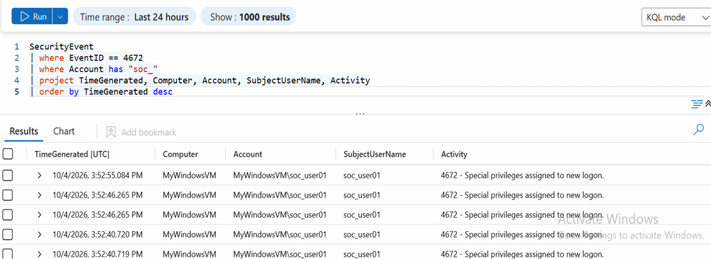

Event ID 4672 indicates that special privileges were assigned to a new logon.

### 7. Process Creation

- Download Sysmon and extract it into the `C:\` folder.
- Open PowerShell as Administrator.
- Run the following commands:

```powershell
cd C:/
.\Sysmon64.exe -i
```

- Click **Agree**.

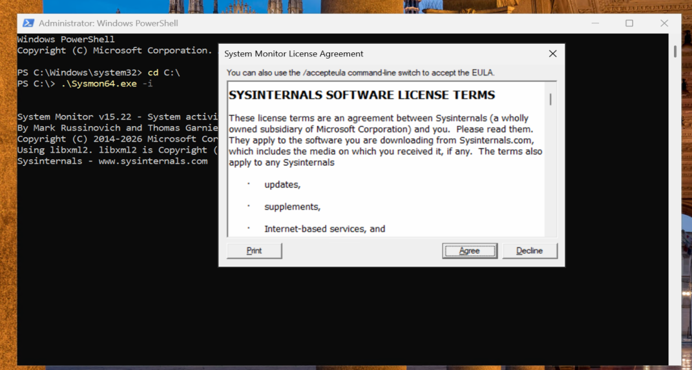

- Check whether Sysmon is running:

```powershell
Get-Service Sysmon64
```

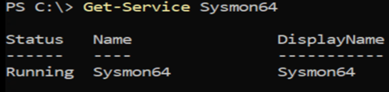

- Check recent Sysmon events:

```powershell
Get-WinEvent -LogName "Microsoft-Windows-Sysmon/Operational" -MaxEvents 10
```

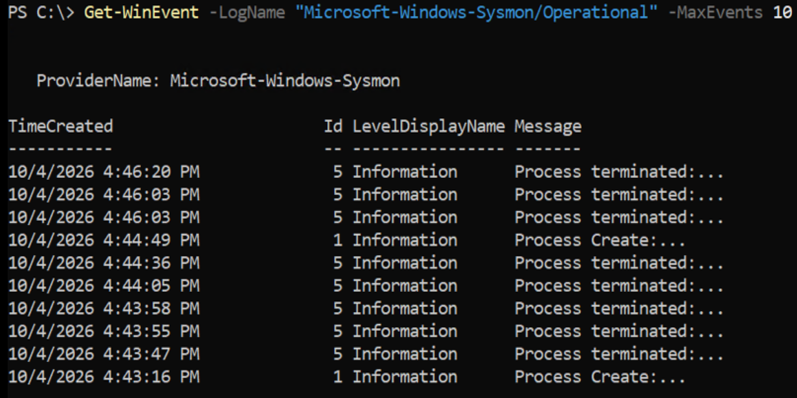

- Generate harmless process activity:
  - `notepad.exe`
  - `whoami`
  - `ipconfig`

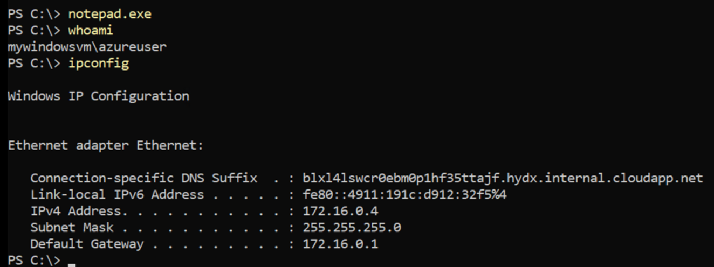

- Then run:

```powershell
Get-Process
```

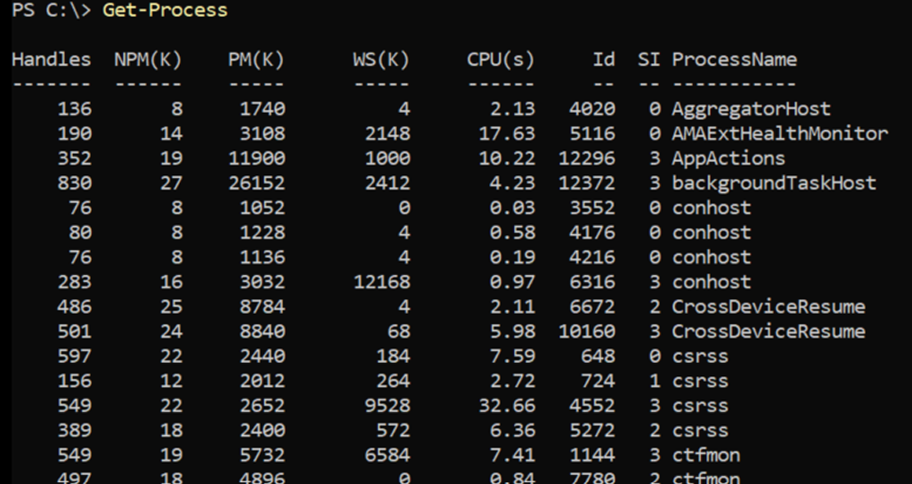

- Search specifically for Sysmon Process Creation events:

```powershell
Get-WinEvent -FilterHashtable @{
    LogName='Microsoft-Windows-Sysmon/Operational'
    Id=1
} -MaxEvents 20
```

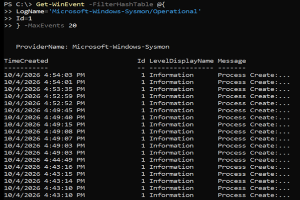

- Sysmon Event ID 1 records process creation.

### 8. PowerShell Investigation

- Open PowerShell.
- Run:

```powershell
Get-Process
```

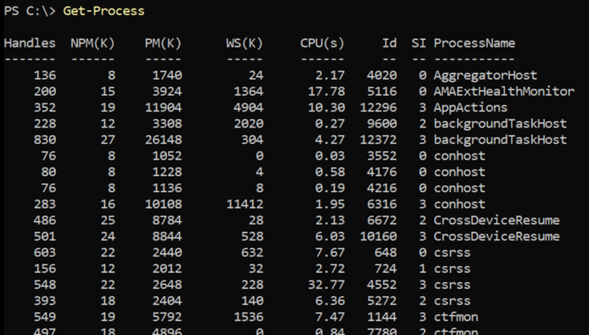

- Run:

```powershell
Get-Service
```

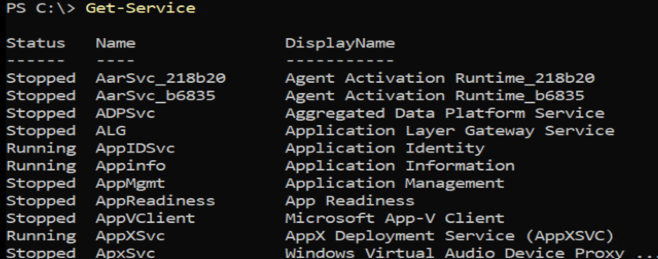

- Investigate the corresponding process telemetry in Sysmon/Sentinel.

### 9. File Creation

- Open PowerShell.
- Create a temporary directory:

```powershell
New-Item C:\Temp -ItemType Directory -Force
```

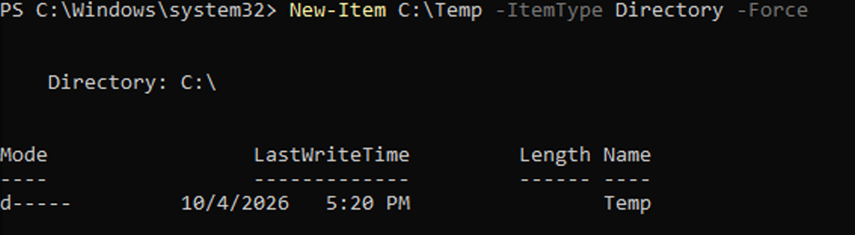

- Create a test file:

```powershell
"Sentinel SOC Lab Test" | Out-File C:\Temp\soc-test.txt
```

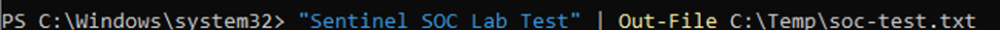

- This generates file-creation activity. Sysmon Event ID 11 records file creation and overwrite activity.

**Verify locally using PowerShell**

- Run:

```powershell
Get-WinEvent -FilterHashtable @{
    LogName='Microsoft-Windows-Sysmon/Operational'
    Id=11
} -MaxEvents 20
```

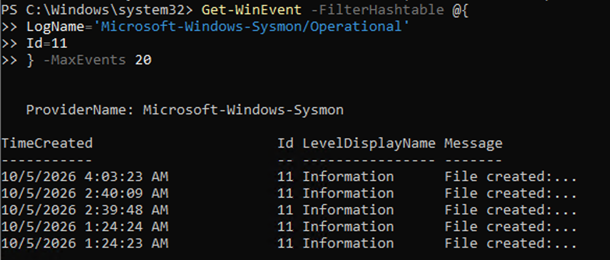

- Investigate: Which process created the file, under which account, and where?

### 10. DNS Investigation

- Open PowerShell.
- Run:

```powershell
nslookup example.com
```

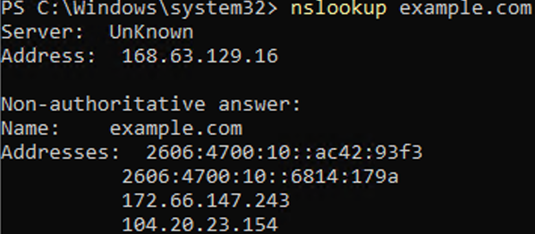

- This generates DNS query activity.
- Sysmon Event ID 22 records DNS query activity.

**Verify locally using PowerShell**

- Run:

```powershell
Get-WinEvent -FilterHashtable @{
    LogName='Microsoft-Windows-Sysmon/Operational'
    Id=22
} -MaxEvents 20
```

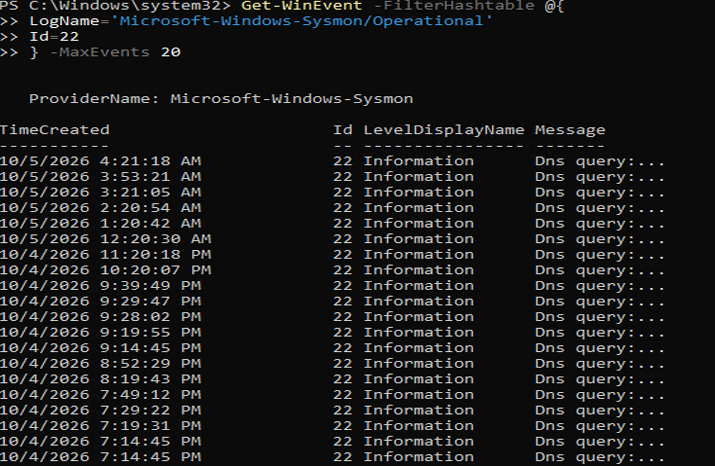

- Result: `nslookup` successfully resolved `example.com`, and Sysmon Event ID 22 confirmed that the DNS query was recorded. This demonstrates basic DNS monitoring and investigation using Sysmon.

### 11. Network Connection

- Open PowerShell.
- Run the following benign connection test:

```powershell
Test-NetConnection example.com -Port 443
```

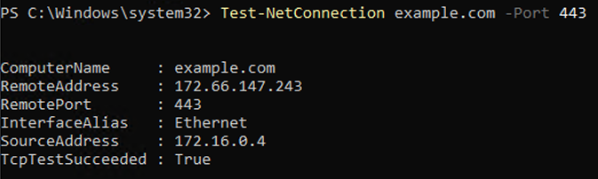

- This tests connectivity to `example.com` on TCP port 443.
- Verify whether the network activity was recorded:

```powershell
Get-WinEvent -FilterHashtable @{
    LogName='Microsoft-Windows-Sysmon/Operational'
    Id=3
} -MaxEvents 10
```

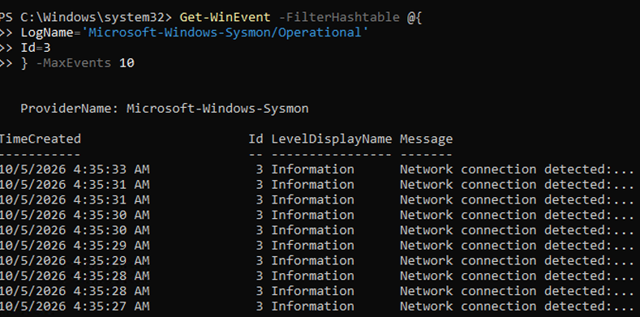

- Sysmon Event ID 3 can record network connections when it is enabled in the Sysmon configuration.

### 12. Registry Modification

- Open Command Prompt.
- Create a dedicated test registry key:

```cmd
reg add HKCU\Software\SOC-Lab /v TestValue /t REG_SZ /d "SentinelDemo" /f
```

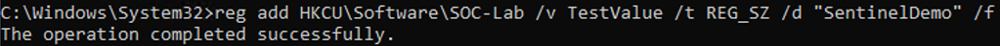

- Meaning of the above command:

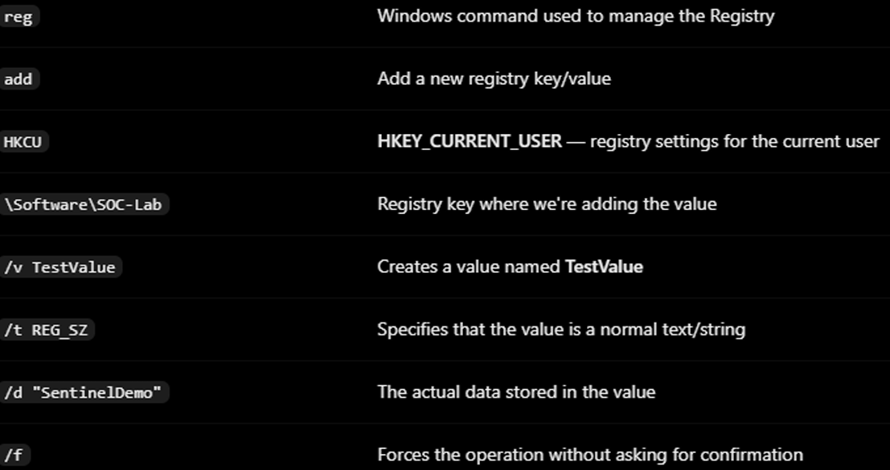

- This creates or modifies a registry value under the current user's registry hive.
- Sysmon Event IDs 12–14 cover registry activity.
- Verify the registry activity:

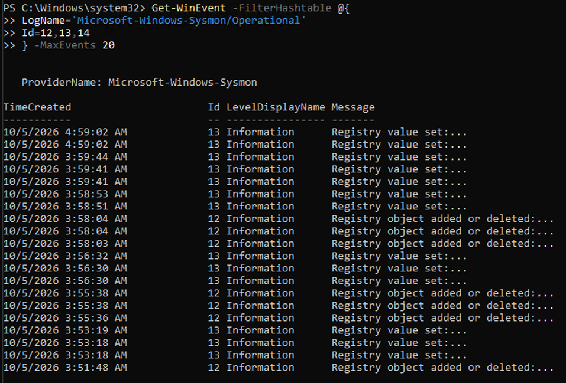

### 13. Account Lockout

- Use a lab account only.
- Username: `soc_test01`
- Enter an incorrect password.
- Generate enough incorrect authentication attempts to trigger the configured Windows account-lockout policy. (In this lab, approximately 10–11 incorrect password attempts.)

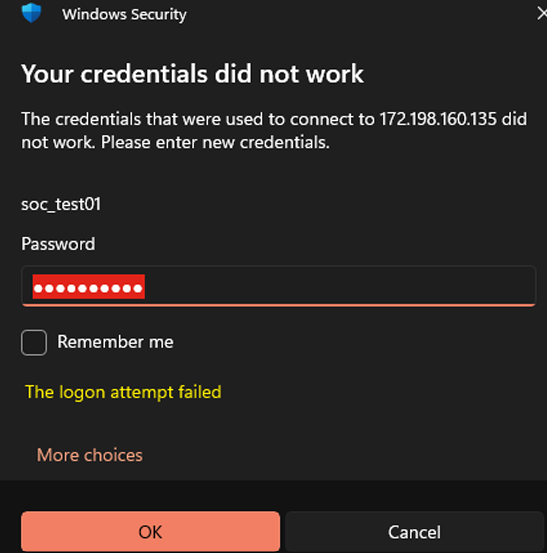

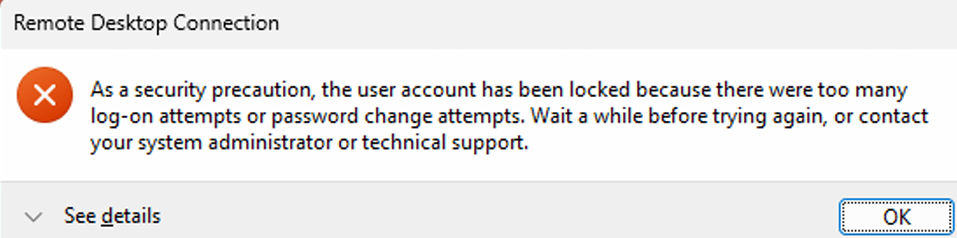

- After the account is locked, open Microsoft Sentinel → `law-soc-lab` → Logs.
- Run:

```kql
SecurityEvent
| where EventID == 4740
| where Account has "soc_"
| project TimeGenerated, Computer, Account, Activity
| order by TimeGenerated desc
```

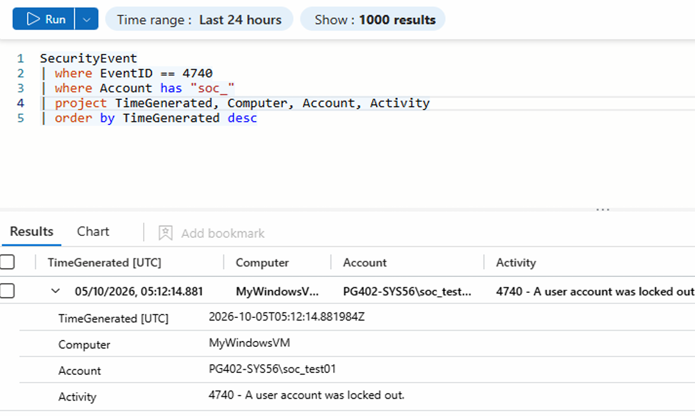

- Event ID 4740 represents an account lockout.

### 14. Scheduled Task

- Open PowerShell as Administrator.
- Create a harmless scheduled task:

```powershell
schtasks /create /sc once /tn "SOC-Lab-Test" /tr "notepad.exe" /st 23:59
```

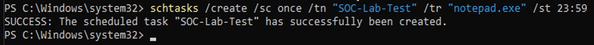

- This creates a scheduled task named `SOC-Lab-Test` that is configured to run `notepad.exe`.
- Open Microsoft Sentinel → `law-soc-lab` → Logs.
- Search for:

```kql
SecurityEvent
| where EventID == 4698
| project TimeGenerated, Computer, SubjectUserName, Activity
| order by TimeGenerated desc
```

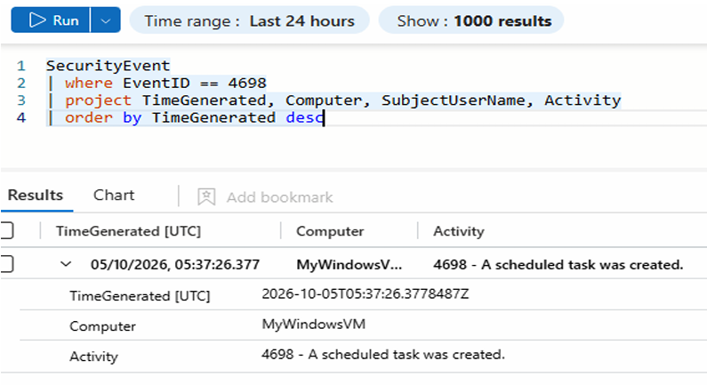

- Event ID 4698 represents scheduled-task creation.

**Cleanup**

- After the demonstration, delete the test task:

```powershell
schtasks /delete /tn "SOC-Lab-Test" /f
```

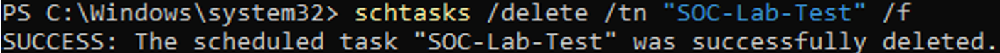

### 15. Security Log Clearing

- Perform this only on your isolated lab VM.
- The objective is to demonstrate that an attempt to clear the Windows Security log can itself generate a security event.
- Open PowerShell as Administrator.
- Run:

```powershell
wevtutil cl Security
```

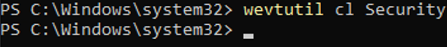

- Check locally for Event ID 1102 using the following command:

```powershell
Get-WinEvent -FilterHashtable @{
    LogName='Security'
    Id=1102
} -MaxEvents 5 | Format-List TimeCreated, Id, Message
```

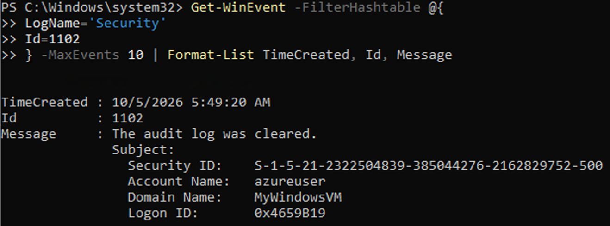

- After performing the lab demonstration, open Microsoft Sentinel → `law-soc-lab` → Logs.
- Search for:

```kql
SecurityEvent
| where EventID == 1102
| project TimeGenerated, Computer, SubjectUserName, Activity
| order by TimeGenerated desc
```

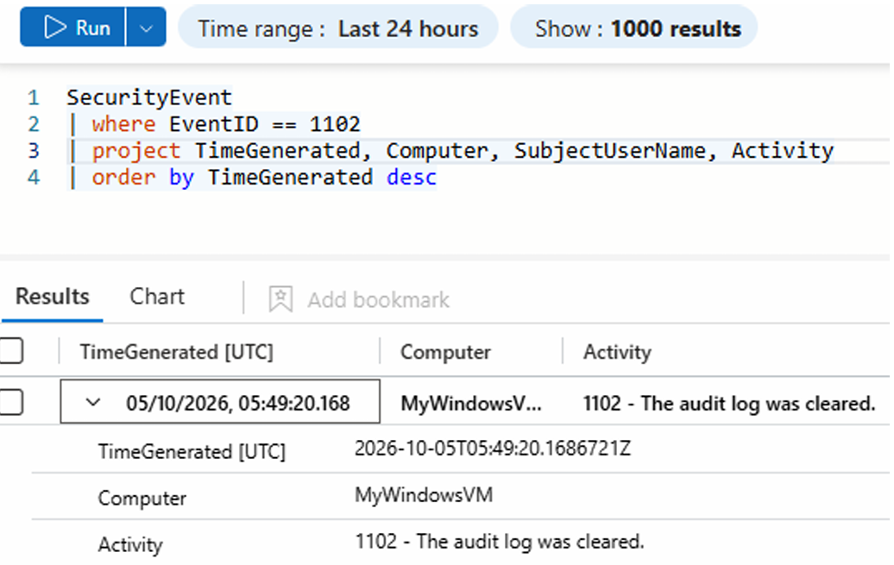

- Event ID 1102 indicates that the Security audit log was cleared.
