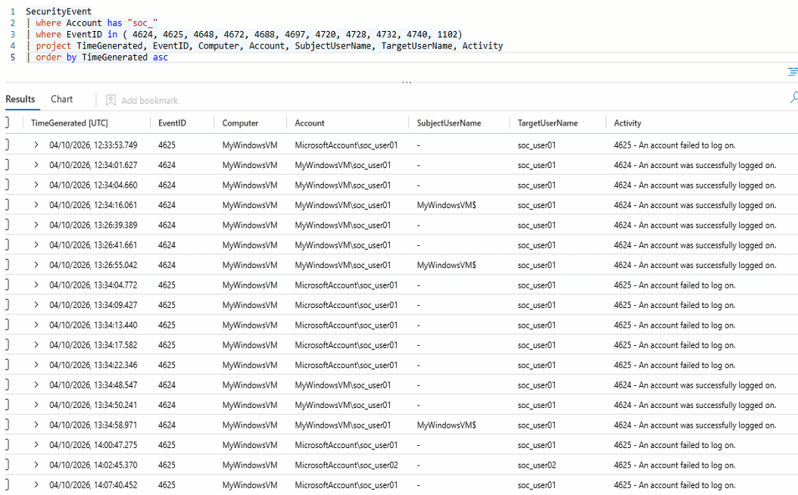
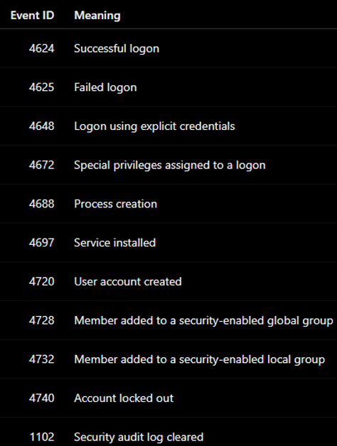
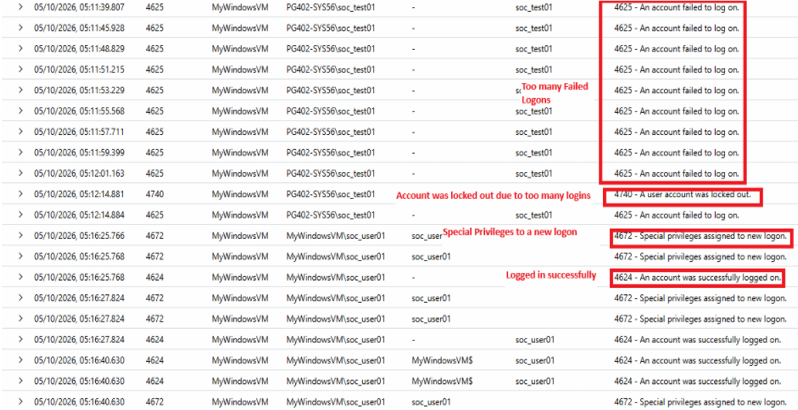

# IX. Master SOC Investigation

## Scenario: Suspicious Administrator Activity

An administrator account on the Windows VM may have been compromised. Determine what happened by correlating the Windows Security events generated during the lab.

## 1. Open Microsoft Sentinel

- Open the Azure Portal.
- Search for Microsoft Sentinel.
- Open `law-soc-lab`.
- Click **Logs**.

## 2. Run the Master Investigation Query

- Enter the following KQL query:

```kql
SecurityEvent
| where Account has "soc_"
| where EventID in (4624, 4625, 4648, 4672, 4688, 4697, 4720, 4728, 4732, 4740, 1102)
| project TimeGenerated, EventID, Computer, Account, SubjectUserName, TargetUserName, Activity
| order by TimeGenerated asc
```



### What This Query Does

- The query looks for events involving your lab accounts whose names contain `soc_`.
- It then limits the results to important security events.
  
   

- The query sorts the events using:

```kql
| order by TimeGenerated asc
```
- This places the oldest event first and the newest event last, allowing you to construct a timeline.


## 3. Construct the Investigation Timeline

- Look at the `TimeGenerated` column.
- Start from the earliest relevant event.
- Record the events in chronological order.
- Pay particular attention to events involving a sequence such as:



The lab's intended investigation storyline is to correlate events rather than interpret one event in isolation.
