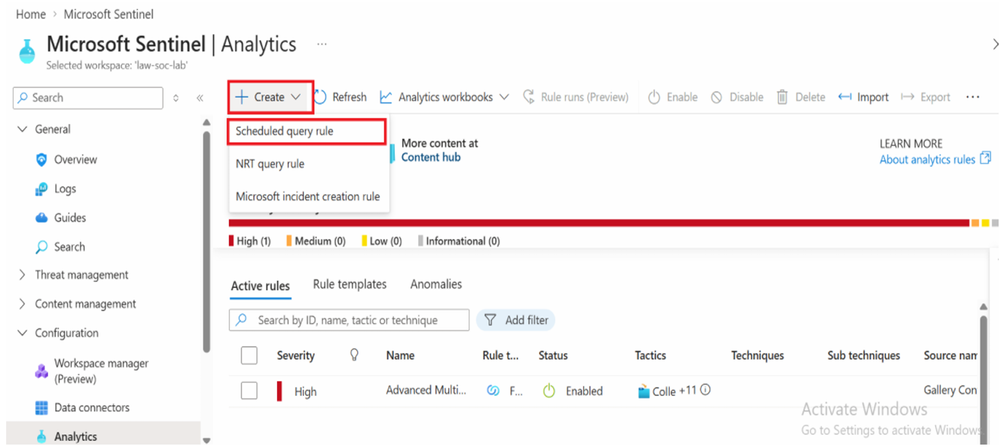
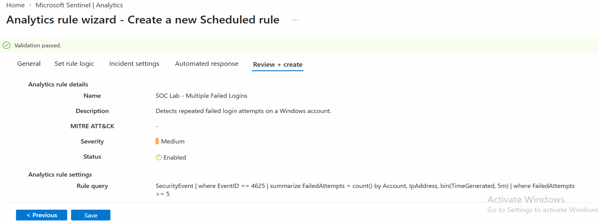
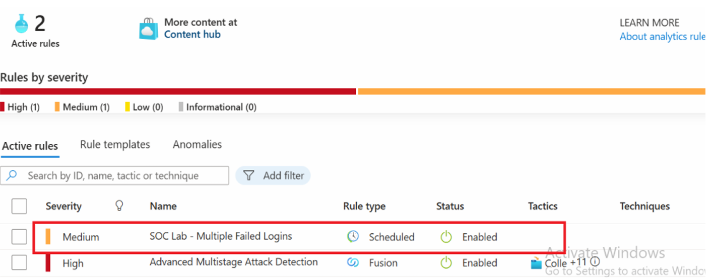
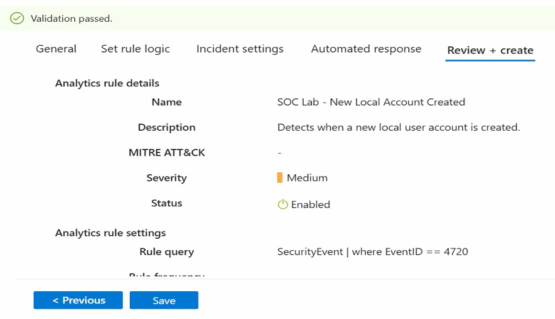
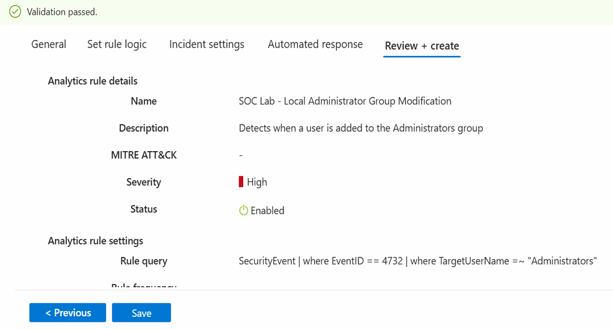
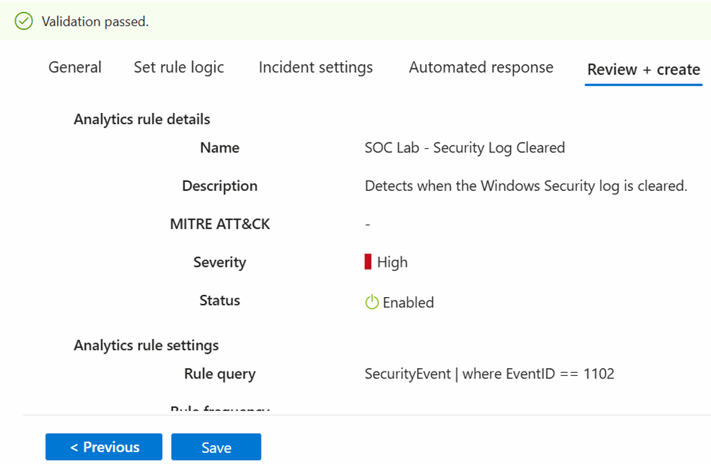
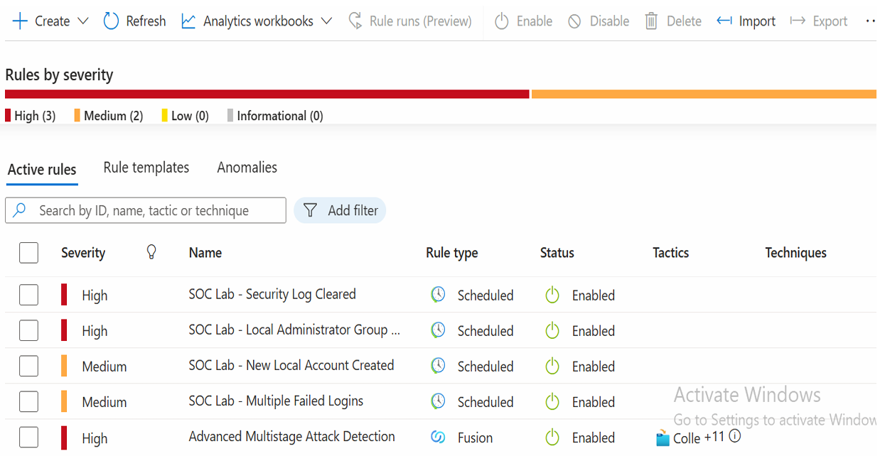

# XI. Create Sentinel Analytics Rules

1. Open the Azure Portal.
2. Open **Microsoft Sentinel**.
3. Select your workspace, `law-soc-lab`.
4. From the left menu, select **Analytics** under the **Configuration** menu.
5. If the message *"This page was moved to Defender portal, please connect your workspace to the Defender portal"* appears, ignore it and refresh the Analytics page by pressing `Ctrl + R`.
6. Click **Create → Scheduled query rule**.

    

## Rule 1 – Multiple Failed Logins

1. Enter the following details:

   - **Rule Name:** `SOC Lab - Multiple Failed Logins`
   - **Description:** Detects repeated failed login attempts on a Windows account.
   - **Severity:** Medium
   - **Status:** Enabled

2. Click **Next**.
3. Under **Rule query**, paste the following KQL query:

   ```kql
   SecurityEvent
   | where EventID == 4625
   | summarize FailedAttempts = count() by Account, IpAddress, bin(TimeGenerated, 5m)
   | where FailedAttempts >= 5
   ```

4. Under **Query scheduling**, configure:
   - **Run query every:** 5 minutes
   - **Lookup data from the last:** 5 minutes

5. Under **Alert threshold**, set the rule to trigger when the number of results is greater than `0`.
6. Keep the remaining settings at their defaults.
7. Click **Review + Create**, then click **Save**.

  

8. After creation, the rule `SOC Lab - Multiple Failed Logins` is displayed.

   

## Rule 2 – New Local Account Created

1. Enter the following details:
   - **Rule Name:** `SOC Lab - New Local Account Created`
   - **Description:** Detects when a new local user account is created.
   - **Severity:** Medium
   - **Status:** Enabled

2. Click **Next**.
3. Under **Rule query**, paste the following KQL query:

   ```kql
   SecurityEvent
   | where EventID == 4720
   ```

4. Under **Query scheduling**, configure:
   - **Run query every:** 5 minutes
   - **Lookup data from the last:** 5 minutes

5. Under **Alert threshold**, set the rule to trigger when the number of results is greater than `0`.
6. Keep the remaining settings at their defaults.
7. Click **Review + Create**, then click **Save**.

  

## Rule 3 – User Added to Administrators

1. Enter the following details:
   - **Rule Name:** `SOC Lab - Local Administrator Group Modification`
   - **Description:** Detects when a user is added to the Administrators group.
   - **Severity:** High
   - **Status:** Enabled

2. Click **Next**.
3. Under **Rule query**, paste the following KQL query:

   ```kql
   SecurityEvent
   | where EventID == 4732
   | where TargetUserName =~ "Administrators"
   ```

4. Under **Query scheduling**, configure:
   - **Run query every:** 5 minutes
   - **Lookup data from the last:** 5 minutes

5. Under **Alert threshold**, set the rule to trigger when the number of results is greater than `0`.
6. Keep the remaining settings at their defaults.
7. Click **Review + Create**, then click **Save**.

  

## Rule 4 – Security Log Cleared

1. Enter the following details:
   - **Rule Name:** `SOC Lab - Security Log Cleared`
   - **Description:** Detects when the Windows Security log is cleared.
   - **Severity:** High
   - **Status:** Enabled

2. Click **Next: Set rule logic**.
3. Under **Rule query**, paste the following KQL query:

   ```kql
   SecurityEvent
   | where EventID == 1102
   ```

4. Under **Query scheduling**, configure:
   - **Run query every:** 5 minutes
   - **Lookup data from the last:** 5 minutes

5. Under **Alert threshold**, set the rule to trigger when the number of results is greater than `0`.
6. Keep the remaining settings at their defaults.
7. Click **Review + Create**, then click **Save**.

   

After creating all the analytical rules, they are displayed as shown below.

  
